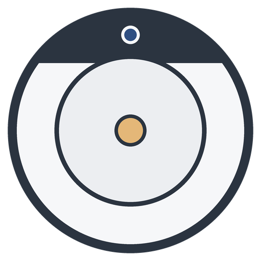

# Dreame 1C (local)

Home Assistant integration for the **Mi Robot Vacuum-Mop 2C** (`dreame.vacuum.md1808`, the
camera-based Dreame 1C/2C), **100% local**: Home Assistant talks to the robot over the miio
protocol on your LAN with [`python-miio`](https://github.com/rytilahti/python-miio). No
Xiaomi cloud, no captcha, no map download.



- Vacuum entity: start, pause, stop, return to dock, locate, suction level.
- **Room cleaning**: one button per room, plus a `dreame_1c.clean_rooms` action with suction,
  water level and passes.
- **Mopping vs. vacuuming**: the robot mops when the water tank is fitted; the integration
  reports `mopping` while cleaning with the tank.
- Sensors for status, warnings, battery, current run, totals and consumables (filter, main
  and side brush: life % and hours left), with reset buttons.
- Mop water level, do-not-disturb and voice volume controls.
- Works with [vacuum-card](https://github.com/denysdovhan/vacuum-card).

The map stays in the Xiaomi app: this model's map isn't readable locally.

> Tested with `dreame.vacuum.md1808`. Its MIoT spec is a superset of the 1C
> (`dreame.vacuum.mc1808`), so the 1C will likely work for everything but mopping.

## Installation

### HACS

1. HACS → ⋮ → **Custom repositories** → add `https://github.com/DanielUlisses/dreame_1c`,
   type **Integration**.
2. Install **Dreame 1C (local)** and restart Home Assistant.

### Manual

Copy `custom_components/dreame_1c` into your `config/custom_components/` and restart.

## Setup

1. Give the robot a fixed IP (a **DHCP reservation** on your router).
2. Get the robot's miio **token** (32 hex characters), e.g. with
   [Xiaomi Cloud Tokens Extractor](https://github.com/PiotrMachowski/Xiaomi-cloud-tokens-extractor).
   The token **changes whenever the robot is reset or re-paired** in the Xiaomi app.
3. **Settings → Devices & services → Add integration → Dreame 1C (local)**, then enter the IP
   and token. The flow checks them by reading the battery level.

A new IP or token later: **Reconfigure** on the integration. It refuses a different robot.

## Rooms

The robot cleans rooms by the **segment ids** of the map saved in the Xiaomi app. It doesn't
report them locally, and it accepts any id without checking it, so you map them once:

1. Configure the integration's options with numbered placeholders, e.g. `1=Room 1, 2=Room 2, …`.
2. Press **Clean Room 1** and watch where the robot goes (the app highlights the room too),
   then send it back to the dock. Repeat for 2, 3, … until it goes nowhere new.
3. Put the real names in the options:

   ```text
   1=Quarto de Hóspedes, 2=Sala de Cinema, 3=Escritório, 4=Suite,
   5=Corredor, 6=Sala de Estar, 7=Sala de Jantar, 8=Cozinha
   ```

Each room gets a **Clean <room>** button (**Limpar <room>** in Portuguese). Removing a room
removes its button. Ids usually follow the order the app segmented the map, starting at 1.

### Rooms as Home Assistant areas (`vacuum.clean_area`)

The configured rooms are also the vacuum's **segments** (HA 2026.3+ `CLEAN_AREA`). Map them
to your HA areas once in **Settings → Devices → Rose → vacuum → Configure**, then
`vacuum.clean_area` cleans by area:

```yaml
action: vacuum.clean_area
target:
  entity_id: vacuum.rose
data:
  cleaning_area_id: [cozinha, sala_de_jantar]
```

[Home Assistant Matter Hub](https://github.com/RiDDiX/home-assistant-matter-hub) picks this
mapping up automatically: Google Home, SmartThings and Alexa get one cleaning mode per room,
Apple Home a room picker. If you change the rooms option later, HA raises a repair asking to
re-map them.

Virtual walls, no-go and no-mop zones live on the robot's map, so the robot respects them no
matter how the clean was started.

### `dreame_1c.clean_rooms`

```yaml
action: dreame_1c.clean_rooms
target:
  entity_id: vacuum.rose
data:
  rooms: [Suite, 2]       # configured names (case-insensitive) or ids
  fan_speed: turbo        # optional: quiet / standard / medium / turbo (default: current)
  water_level: low        # optional: low / medium / high (default: current)
  repeats: 2              # optional: passes per room, 1-3 (default 1)
```

## Entities

| Platform | Entities |
|---|---|
| `vacuum` | start (full clean; also resumes), pause, stop, return to dock, locate, suction, clean by HA area |
| `binary_sensor` | water tank fitted |
| `sensor` | status (incl. `mopping`), warning, fault code, battery, area and time of the current run, total time / count / area, filter / main brush / side brush life (%) and hours left, work mode (disabled by default) |
| `select` | mop water level |
| `switch` | do not disturb (the window itself is set in the Xiaomi app) |
| `number` | voice volume |
| `button` | reset filter / main brush / side brush, one per configured room |

Vacuum attributes:

- `battery_level`, `status`: what vacuum-card shows. `status` is the card's own key
  (translated by the card), or "Mopping" / "Passando pano" while mopping.
- `cleaning_mode`: `mopping` or `vacuuming`.
- `cleaning_rooms`: rooms being cleaned, when the room clean was started from Home Assistant
  (buttons or the action). Empty for cleans started in the Xiaomi app.
- `rooms`: the configured rooms.

## vacuum-card

```yaml
type: custom:vacuum-card
entity: vacuum.rose
battery_entity: sensor.rose_battery
stats:
  default:
    - entity_id: sensor.rose_filter_life
      unit: "%"
      subtitle: Filter
    - entity_id: sensor.rose_main_brush_life
      unit: "%"
      subtitle: Main brush
    - entity_id: sensor.rose_side_brush_life
      unit: "%"
      subtitle: Side brush
  cleaning:
    - attribute: cleaning_rooms
      subtitle: Room
    - entity_id: sensor.rose_cleaning_area
      unit: m²
      subtitle: Area
    - entity_id: sensor.rose_cleaning_time
      unit: min
      subtitle: Time
shortcuts:
  - name: Kitchen
    icon: mdi:countertop
    service: dreame_1c.clean_rooms
    service_data: { entity_id: vacuum.rose, rooms: [Kitchen] }
```

Colours come from the card's `vc-*` theme variables (see the vacuum-card README).

## Google Home

Google Assistant has no rooms for vacuums, but it exposes `button` entities as scenes: expose
the room buttons and say "Hey Google, activate Clean Kitchen".

## Development

```bash
pip install -r requirements_test.txt
pytest -q
```

The tests run the integration in Home Assistant against a fake robot.

## Releases

Push a tag like `v0.2.0`: the release workflow sets the manifest version from the tag,
attaches `dreame_1c.zip` and publishes a GitHub release with generated notes. HACS installs
from these releases.
